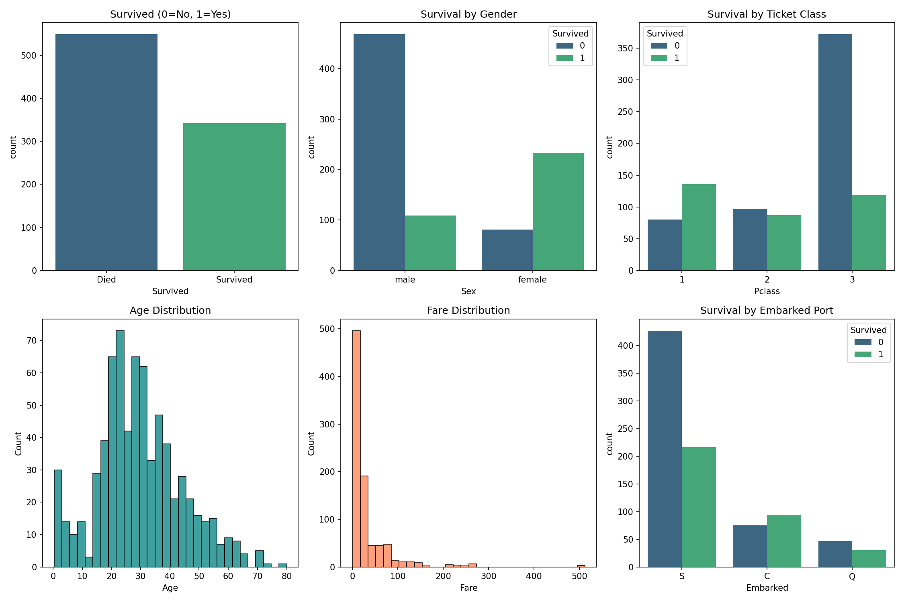
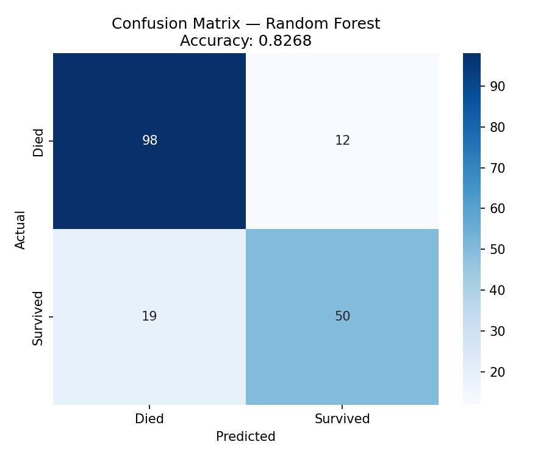
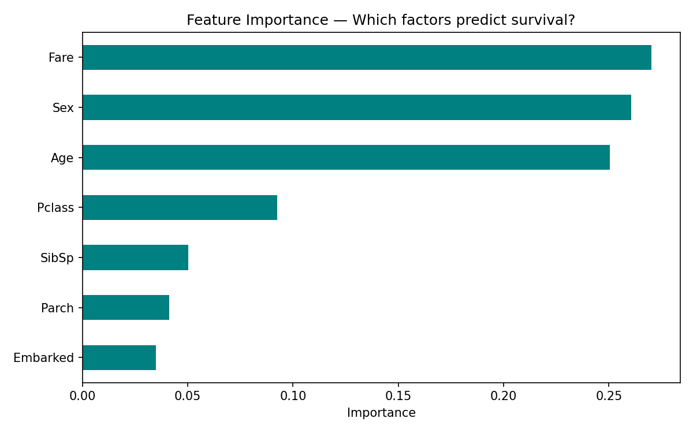

# 🚢 Titanic Survival Prediction

**CODEVEDX Internship — Task 1**

## Objective
Predict whether a passenger on the Titanic survived or not based on 
features like age, gender, ticket class, fare, and embarkation port.

## Dataset
- **Source:** Kaggle Titanic Dataset
- **Rows:** 891 passengers
- **Features:** Pclass, Sex, Age, SibSp, Parch, Fare, Embarked
- **Target:** Survived (0 = Died, 1 = Survived)

## Approach
1. Loaded and explored the dataset
2. Handled missing values (Age → median, Embarked → mode, dropped Cabin)
3. Encoded categorical features (Sex, Embarked)
4. Compared Logistic Regression vs Random Forest
5. Evaluated using Accuracy, Precision, Recall, F1-Score
6. Built interactive Streamlit app

## Results
| Metric | Value |
|---|---|
| Best Model | FILL IN |
| Accuracy | FILL IN |

## Key Findings
- Women survived at much higher rates than men
- 1st class passengers had highest survival rate
- Higher fare correlated with survival
- Children had better survival chances

## Visualizations

### EDA


### Confusion Matrix


### Feature Importance


## Tech Stack
Python, Pandas, NumPy, Scikit-learn, Matplotlib, Seaborn, Streamlit

## How to Run
```bash
